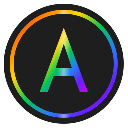

# Adapt VS Code



A complete adaptive theming solution for VS Code and Cursor that automatically responds to your system accent color.

## What's Included

This extension pack bundles two extensions that work together to create a unified, accent-aware VS Code experience:

### 1. Adapt Theme (Color Theme)
A dynamic color theme that generates all UI colors based on your system accent color.

- Automatically detects your system accent color (KDE, GNOME, macOS, Windows)
- Generates a complete dark theme with colors derived from your accent
- Watches for system accent changes and updates in real-time
- Option to set a custom accent color

### 2. Adapt Icons (Icon Theme)
A dynamic icon theme that converts file and folder icons to monochrome using your accent color.

- Converts any icon set to monochrome with your accent color
- Supports loading icons from external icon theme sources
- Maintains icon shape/detail while unifying the color scheme
- Updates automatically when your accent color changes

## Features

- **Cross-Platform Support**: Works on Linux (KDE, GNOME), macOS, and Windows
- **Real-Time Updates**: Automatically detects and responds to system accent color changes
- **Unified Look**: Both theme and icons use the same accent color for a cohesive appearance
- **Customizable**: Override the system accent with any hex color you prefer
- **Lightweight**: Minimal performance impact

## Installation

1. Install this extension pack from the VS Code Marketplace (VS Code) or Open VSX (Cursor)
2. Open Command Palette (`Ctrl+Shift+P` / `Cmd+Shift+P`)
3. Select **Preferences: Color Theme** → **Adapt Dark**
4. Select **Preferences: File Icon Theme** → **Adapt Icons**

### Cursor

Cursor is built on VS Code and runs VS Code extensions. It installs extensions from [Open VSX](https://open-vsx.org/) rather than the VS Code Marketplace:

1. Open the **Extensions** view in Cursor (`Ctrl+Shift+X` / `Cmd+Shift+X`) and search for **Adapt VS Code**, or
2. Install a packaged `.vsix` directly:

   ```bash
   cursor --install-extension adapt-vscode-0.1.0.vsix
   ```

   (or drag the `.vsix` onto the Extensions view, or use **Extensions: Install from VSIX...** from the Command Palette)

The pack pulls in `Tone.adapt-vscode-colors` and `Tone.adapt-vscode-icons` from the same registry, so both must be published to Open VSX for it to install in Cursor.

## Configuration

### Adapt Theme Settings

| Setting | Description | Default |
|---------|-------------|---------|
| `adaptTheme.accentColor` | Custom accent color (hex). Leave empty for system accent. | `""` |
| `adaptTheme.watchSystemAccent` | Auto-update when system accent changes | `true` |
| `adaptTheme.watchInterval` | Polling interval in milliseconds | `5000` |

### Adapt Icons Settings

| Setting | Description | Default |
|---------|-------------|---------|
| `adaptIcons.accentColor` | Custom accent color (hex). Leave empty for system accent. | `""` |
| `adaptIcons.iconThemeSourcePath` | Path to source icon theme for conversion | `""` |
| `adaptIcons.watchSystemAccent` | Auto-update when system accent changes | `true` |
| `adaptIcons.watchInterval` | Polling interval in milliseconds | `5000` |
| `adaptIcons.autoReload` | Auto-reload window on accent change | `false` |

## Commands

- **Adapt Theme: Refresh from System Accent** - Manually refresh the color theme
- **Adapt Theme: Set Custom Accent Color** - Set a custom accent color
- **Adapt Icons: Refresh from System Accent** - Manually refresh icons
- **Adapt Icons: Set Custom Accent Color** - Set a custom accent color for icons
- **Adapt Icons: Set Icon Theme Source Path** - Select an icon theme to convert
- **Adapt Icons: Debug Info** - Show debug information

## Using with External Icon Themes

The Adapt Icons extension can convert any compatible icon theme to monochrome:

1. Clone or download an icon theme (e.g., [A-WL File Icon Theme](https://github.com/ArturoWL/a-wl-file-icon-vscode))
2. Run command **Adapt Icons: Set Icon Theme Source Path**
3. Select the root folder of the icon theme
4. The icons will be converted to monochrome using your accent color

## Editor Support

| Editor | Supported | Notes |
|--------|-----------|-------|
| VS Code 1.85+ | ✅ | Installed from the VS Code Marketplace |
| Cursor | ✅ | Installed from Open VSX; blur effects need a writable (non-AppImage) install |

## Platform Support

| Platform | Accent Detection | Real-time Updates |
|----------|-----------------|-------------------|
| KDE Plasma | ✅ | ✅ (via dbus) |
| GNOME | ✅ | ✅ (via dconf) |
| macOS | ✅ | ✅ |
| Windows | ✅ | ✅ (via registry) |

## Screenshots

*Coming soon*

## Building & Publishing

```bash
npm run package          # builds adapt-vscode-<version>.vsix
npm run publish:vscode   # VS Code Marketplace (needs a VSCE_PAT)
npm run publish:openvsx  # Open VSX, used by Cursor, VSCodium, etc. (needs an OVSX_PAT)
```

Cursor installs extensions from Open VSX, so publish there for the extension to be found in Cursor's Extensions view.

### Releasing with GitHub Actions

`.github/workflows/publish.yml` packages the extension and publishes it to both registries. It needs two repository secrets (**Settings → Secrets and variables → Actions**):

| Secret | Where to get it |
|--------|-----------------|
| `VSCE_PAT` | Azure DevOps personal access token, organization **All accessible organizations**, scope **Marketplace → Manage** |
| `OVSX_PAT` | [open-vsx.org](https://open-vsx.org/user-settings/tokens) access token (the `Tone` namespace must exist and belong to you) |

Publish **Adapt Colors** and **Adapt Icons** first: the pack only lists them by ID, so they must already be on each registry for the pack to install.

Then bump `version` in `package.json`, add a CHANGELOG entry, and push a matching tag:

```bash
git tag v0.1.0 && git push origin v0.1.0
```

The workflow can also be run manually from the **Actions** tab, with a choice of registries. Versions already on a registry are skipped, so re-running is safe.

## Contributing

Contributions are welcome! Please feel free to submit issues and pull requests.

## License

MIT License - see [LICENSE](LICENSE) for details.
